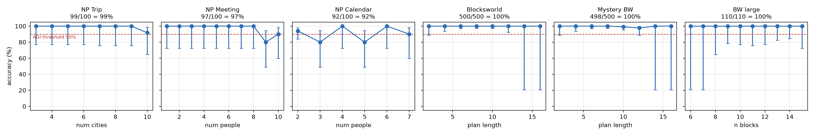

# Planning

To get the 1% for planning in [A Definition of AGI](https://www.agidefinition.ai/), a model needs at least 90% accuracy on **both** Natural Plan (Zheng et al., 2024) and PlanBench Blocksworld (Valmeekam et al., 2023). Like the other categories, the model is Claude Opus 5.5 with medium effort, run through Claude Code with every tool turned off (see [Theory of Mind](../theory_of_mind/README.md) for why Claude Code is used instead of the API, and for the check that both give the same results).

## Benchmarks

**Natural Plan** ([google-deepmind/natural-plan](https://github.com/google-deepmind/natural-plan)) has three natural-language planning tasks. All the information a planner needs (flights, travel times, calendars) is given in the prompt:

- *Trip planning* (1,600 items): visit 3–10 European cities for given numbers of days, using only direct flights and meeting fixed-date constraints. There is exactly one correct plan.
- *Meeting planning* (1,000 items): meet as many of 1–10 friends as possible in San Francisco, given where and when each is available and the travel times between places.
- *Calendar scheduling* (1,000 items): find the one meeting slot that fits the calendars of 2–7 people (one day), or of 2 people over 1–5 days.

We use the paper's 5-shot prompts. We sample 100 items per task, stratified by problem size (equal numbers per number of cities, people, or people × days), so we can also see how accuracy changes with problem size.

**PlanBench Blocksworld** ([karthikv792/LLMs-Planning](https://github.com/karthikv792/LLMs-Planning)), task 1 "plan generation". The prompt describes the four actions (pick up, put down, stack, unstack) and their rules, shows one solved example, then gives a new start state and goal. The model has to write the whole action sequence. The current repository has 500 instances for this task (the paper reports 600). They have 4–5 blocks and reference plans of 2–16 steps.

**Large Blocksworld** (110 instances, 6–15 blocks, optimal plans 20–40 steps), from Valmeekam et al. (2024). There o1-preview fell from 97.8% on the standard set to 23.6%. These instances come without natural-language prompts, so we render them in the same task 1 format with the same one-shot example. Blocks beyond the 12 standard colours are named brown, pink, purple and teal.

**Mystery Blocksworld** (robustness / memorization check). These are the same 500 problems, but every action and predicate gets an unrelated name: "attack object a" instead of "pick up the red block", "object a craves object b" instead of "the red block is on top of the blue block". For a classical planner the two versions are identical. If the model's success depends on having seen Blocksworld text before, accuracy should drop. In the PlanBench paper GPT-4 fell from 34% to 4%. The instance order is the same in both files, so the first N items are the same problems and can be compared pairwise.

## Scoring

- Natural Plan: [score.py](score.py) uses the same parsing and exact-match rules as the official evaluation scripts. As a check, it reproduces the published Gemini 1.5 Pro results on our 100-item samples (ours 35 / 35 / 45% vs. 34.8 / 39.1 / 48.9% in the paper for trip / meeting / calendar).
- Blocksworld: the model's plan is executed from the initial state. Every action must be allowed in the state it is applied to, and the goal must hold at the end, which is the check VAL does in the original framework. As a check, the reference plans score 500/500, and the same plans with their first action removed score 0/500, in both domains.

Statistics: accuracy with 95% Wilson confidence intervals; a one-sided exact binomial test of whether accuracy is below 90%; logistic regression of correctness on problem size; exact McNemar test for Blocksworld vs. Mystery Blocksworld on the same instances.

## How to run

```
python -m venv .venv                    # once, in the repository root
.venv\Scripts\pip install -r planning\requirements.txt
cd planning
git clone --depth 1 https://github.com/google-deepmind/natural-plan external/natural-plan
git clone --depth 1 https://github.com/karthikv792/LLMs-Planning external/LLMs-Planning
python prepare_data.py                  # only needed if subsets/ is missing
python run_claude.py --questions subsets/blocksworld.jsonl --limit 20
python score.py --figure figures/accuracy_by_complexity.png
```

`run_claude.py` needs the `claude` command (Claude Code) logged in to a Claude subscription. Re-running the same command continues where it stopped, for example after hitting a usage limit. The first N items of every file are a balanced random sample, so `--limit` gives a fair pilot run.

## Results

All 1,410 items were run with Claude Opus 5.5 (medium effort, Claude Code, no tools). Every call used one turn and made no web requests.

| Benchmark | n | Accuracy | 95% CI (Wilson) |
|---|---|---|---|
| Natural Plan – Trip | 100 | 99.0% | 94.6–99.8% |
| Natural Plan – Meeting | 100 | 97.0% | 91.5–99.0% |
| Natural Plan – Calendar | 100 | 92.0% | 85.0–95.9% |
| **Natural Plan, mean of tasks** | 300 | **96.0%** | |
| **Blocksworld** | 500 | **100.0%** | 99.2–100% |
| Mystery Blocksworld | 500 | 99.6% | 98.6–99.9% |
| Large Blocksworld (6–15 blocks) | 110 | 100.0% | 96.6–100% |



Both benchmarks are above the 90% threshold, so Claude Opus 5.5 earns the 1% for planning. Details are in [results/summary.md](results/summary.md).

**The 12 errors.**
- *Calendar (8):* we checked every one by hand against all calendars and constraints. All 8 proposed times are valid. The items have more than one free slot, but the benchmark accepts only one, so these are benchmark ambiguities rather than planning errors. Counting valid answers as correct, calendar accuracy would be 100%, and the Natural Plan mean would be 98.7%.
- *Meeting (3):* the plans are valid but meet one friend fewer than the optimum. These happened only with 9–10 friends (logistic regression on number of people: OR = 0.38, p = 0.09).
- *Trip (1):* this was at 10 cities, the largest size.
- *Mystery Blocksworld (2):* the model tried to pick up a block that had another block on it. Both were long instances (10 and 12 steps).

**Memorization check.** Renaming every action and predicate (Mystery Blocksworld) barely changed accuracy: 100% vs. 99.6% on the same 500 problems, with 2 discordant pairs (exact McNemar p = 0.5). For comparison, GPT-4 dropped from 34% to 4% under the same change, and o1-preview from 97.8% to 52.8%. The large instances, where o1-preview fell to 23.6%, were also solved perfectly. This suggests the high scores reflect planning ability rather than recall of familiar Blocksworld text.

**Limitations.**
- Natural Plan was sampled at 100 items per task, not the full 3,600. With all answers near ceiling, the confidence intervals still exclude 90% only for trip and meeting.
- The large instances use our own rendering of the prompts, not the exact prompts of Valmeekam et al. (2024).
- Blocksworld plans are checked by our own simulator instead of VAL; it accepts all reference plans and rejects truncated ones.
- Each item was asked once, so run-to-run variation was not measured.
